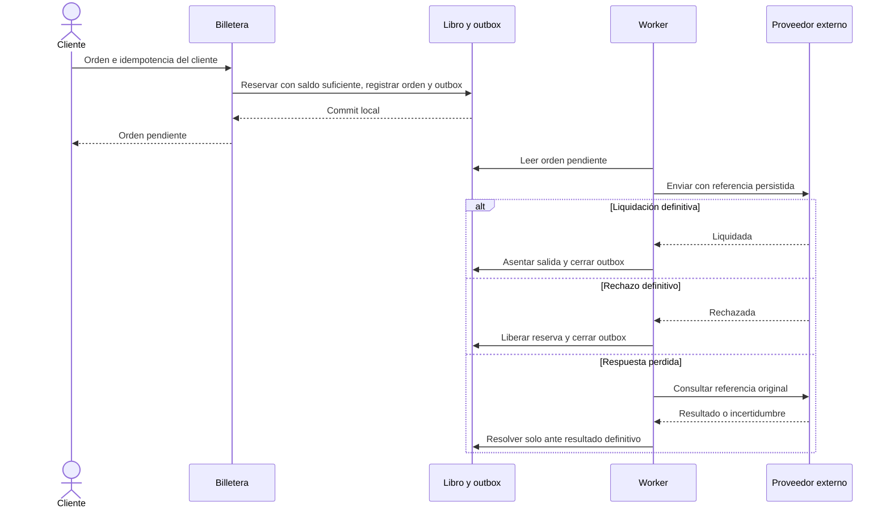

# Saldo en tránsito

Una billetera tiene $100. Llegan dos transferencias de $80. ¿En qué momento puede prometer cada salida? Después el proveedor mueve el dinero y se pierde la respuesta. ¿Quién sabe ahora qué pasó?

[Abrir la demo pública](https://marianoalvez.github.io/saldo-en-transito/) · [Ver las pruebas](tests/transfers.test.mjs) · [Ejecutar localmente](#cómo-revisarlo)

Abrí **Respuesta perdida**. El proveedor ya envió $80 y la billetera muestra $20 disponibles y $80 reservados. Son los mismos $80 vistos desde dos sistemas. Pulsá **Consultar al proveedor** para ver cómo la billetera confirma la salida. Cada escenario abre en su incidente. **Anterior** permite revisar la reserva y el saldo de apertura.

Compará ese cierre con **Reintento del mismo envío**. La consulta deja un pedido de envío y una consulta. El reintento deja dos pedidos de envío y cero consultas. En ambos casos el proveedor liquida una sola transferencia. Los contadores se leen del registro de operaciones del proveedor simulado.

## La decisión

Primero se reserva saldo con una escritura condicional. En esa **misma transacción local** entran la intención de transferencia, el asiento de reserva y la orden de envío en una outbox. Después del commit, un worker usa la referencia persistida para enviar. El cliente puede conocer la orden aceptada mientras su liquidación sigue pendiente.

El proveedor del ensayo ofrece deduplicación por referencia y consulta por esa misma referencia. Ante una respuesta incierta, el dinero sigue reservado. Una respuesta definitiva permite registrar la salida o liberar la reserva. Cada movimiento del diario tiene origen, destino e importe en centavos. Una compensación agrega un movimiento y conserva el original.



## Qué expone cada comparación

| Incidente | Alternativa comparada | Consecuencia con una orden de $80 |
| --- | --- | --- |
| [Dos órdenes distintas de $80](https://marianoalvez.github.io/saldo-en-transito/#race) | Autorizar el envío antes de reservar | Ambas pueden salir. Con $100 de apertura faltarían $60 para cubrirlas. |
| [Caída antes del envío](https://marianoalvez.github.io/saldo-en-transito/#crash) | Guardar el débito y encolar en memoria | El cliente ve $20. Afuera salieron $0 y el proceso perdió la orden. |
| [Respuesta perdida](https://marianoalvez.github.io/saldo-en-transito/#timeout) | Llamar al proveedor dentro de la transacción SQL y hacer rollback | La pantalla puede volver a mostrar $100 aunque ya salieron $80. |
| [Rechazo definitivo](https://marianoalvez.github.io/saldo-en-transito/#decline) | Dar el débito por final sin compensación | El proveedor envía $0 y el cliente queda con $20 disponibles. |
| [Reintento del mismo envío](https://marianoalvez.github.io/saldo-en-transito/#repeat) | Asignar una referencia externa distinta a cada intento | El proveedor puede interpretar el reintento como una segunda orden y enviar $160. |

La columna principal de la demo ejecuta SQL en dos bases independientes en el navegador. La alternativa es una [proyección contable](src/counterfactual.mjs) para el mismo escenario. La UI recorre una secuencia reproducible. La prueba nativa de contención usa dos hilos, una barrera y dos conexiones independientes sobre el mismo archivo SQLite. Con $40 en cada orden deben pasar ambas.

## Cómo revisarlo

- [Reserva, diario y resolución](src/book.mjs). El identificador del cliente es único por cuenta. Reusar la clave con un importe o destino distinto produce un conflicto. Dos claves diferentes compiten por el mismo saldo.
- [Proveedor y worker](src/rail.mjs). Una referencia estable es válida en los reintentos. Dos respuestas iguales producen una sola resolución local. Una resolución terminal contradictoria exige investigar.
- [Ensayos que alimentan la interfaz](src/cases.mjs). Los datos nacen en el navegador y se reinician al elegir un escenario.
- [Pruebas de concurrencia, caída y conciliación](tests/transfers.test.mjs). La reserva y la outbox también se someten a un fallo dentro del mismo commit.

Con Node 24 y npm:

```sh
npm ci
npm test
npm run build
npx playwright install chromium
node scripts/check-browser.mjs
```

Para abrir la interfaz local después del build, ejecutá `npm start` y visitá `http://127.0.0.1:4186`. El selector abre cada incidente directamente y el botón principal permite resolverlo.

## Dónde termina la garantía

Una sola cuenta y moneda, saldos iniciales ficticios y un proveedor simulado. SQLite serializa los escritores. La demo verifica integridad y recuperación, no mide capacidad de una billetera en producción. El riel ficticio conserva referencias durante todo el ensayo y distingue liquidación final y rechazo final. Una aceptación HTTP real puede ser apenas el inicio del procesamiento. Los tiempos, retornos posteriores, límites, comisiones y liquidación dependen del riel contratado.

Antes de integrar un riel real hay que definir qué señal es definitiva, el alcance y la retención de las claves, cómo se autentican los avisos y cómo se contrasta el libro con reportes de liquidación. Sin deduplicación o con una clave vencida, un envío ambiguo se concilia o escala a operación antes de otro intento. Un retorno posterior a una liquidación necesita su propio asiento vinculado. En este laboratorio el worker se avanza por pasos y no hay servicio de pagos accesible. El costo del diseño es explícito: fondos inmovilizados durante la incertidumbre y una cola y conciliación que hay que operar.

## Fundamento técnico

La reserva y resolución en dos fases se pueden contrastar con [TigerBeetle](https://docs.tigerbeetle.com/coding/two-phase-transfers/). La persistencia conjunta de la intención y el trabajo pendiente sigue el [transactional outbox de AWS](https://docs.aws.amazon.com/prescriptive-guidance/latest/cloud-design-patterns/transactional-outbox.html). El alcance y la vigencia de la idempotencia dependen del proveedor, como documenta [Adyen](https://docs.adyen.com/development-resources/api-idempotency/). Son referencias de diseño. El laboratorio no representa a una entidad bancaria.

[Producto](docs/producto/01-prd.md) · [Decisiones técnicas](docs/producto/02-trd.md) · [Diseño](docs/producto/03-diseno-ui-ux.md) · [Flujos](docs/producto/04-appflow.md) · [Datos](docs/producto/05-esquema-backend.md) · [Implementación](docs/producto/06-plan-implementacion.md)

Proyecto de portafolio de Mariano Alvez, desarrollado con asistencia de IA y datos ficticios.
